# Deciphering Big Data

## Module Overview

This e-portfolio documents my learning and development throughout the Deciphering Big Data module. It contains selected artefacts from the module activities, collaborative discussions, practical work and assessments, together with reflections on the knowledge and skills I developed.

## Unit 1: Introduction to Big Data Technologies and Data Management

### Collaborative Discussion 1 – The Data Collection Process

In Unit 1, I participated in the collaborative discussion on the use of Internet of Things (IoT) technologies for large-scale data collection. I considered the opportunities provided by connected devices alongside challenges relating to data quality, privacy and security.

The discussion helped me understand that collecting larger volumes of data does not necessarily result in more useful or reliable information. Issues such as missing, inaccurate and duplicated data can affect subsequent analysis and therefore require appropriate data preparation and management.

Peer feedback also encouraged me to consider practical approaches for reducing IoT security risks, including authentication, encryption, software updates and monitoring. This helped me recognise how peer discussion can identify areas where my initial analysis can be developed further.

### Evidence

- Initial post for Collaborative Discussion 1
  
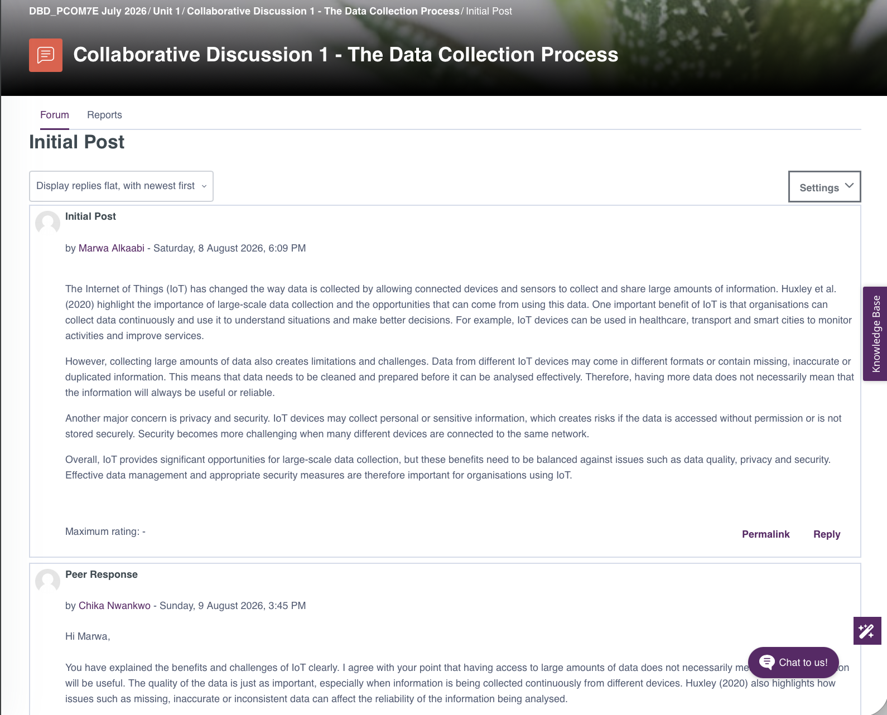

## Unit 2: Introduction to Data Types and Formats

### Collaborative Discussion 1 – Peer Responses

In Unit 2, I continued Collaborative Discussion 1 by responding to my peers' contributions on IoT and large-scale data collection. This activity allowed me to move beyond my initial analysis and critically consider different perspectives on data quality, security and the reliability of IoT data.

Through my peer responses, I explored how continuously generated IoT data requires ongoing monitoring and validation rather than relying only on data cleaning at the final stage of analysis. I also considered how cybersecurity weaknesses can affect not only privacy but also the integrity and reliability of organisational data. This developed my understanding that effective data management requires an integrated approach combining data quality, cybersecurity, privacy protection and continuous risk management.

Engaging with my peers also helped me develop my critical evaluation skills, as I had to compare their arguments with academic literature and provide evidence-based responses rather than simply agreeing or disagreeing.

### Evidence

- Peer response discussing IoT data quality, continuous monitoring and validation.

- Peer response discussing cybersecurity, privacy, data integrity and IoT governance.

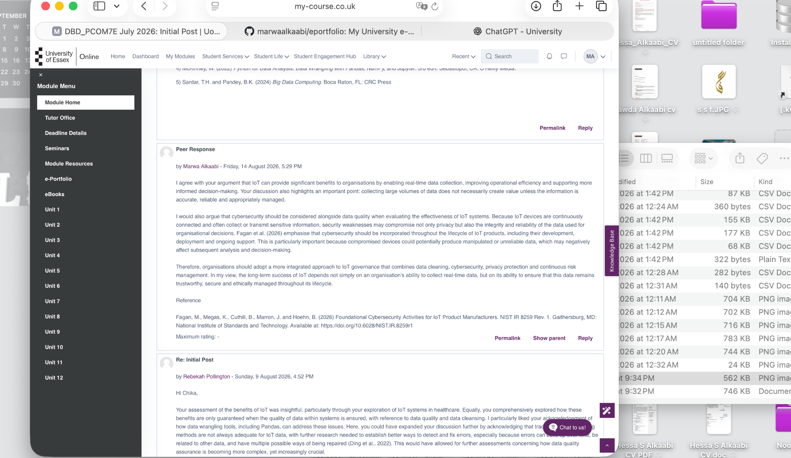

## Unit 3: Data Collection and Storage

### Collaborative Discussion 1 – Summary Post

In Unit 3, I completed the final summary post for Collaborative Discussion 1. This activity brought together my learning from Units 1, 2 and 3, as well as the feedback and different perspectives shared during the collaborative discussion.

Through this activity, I developed a better understanding of the opportunities and challenges associated with large-scale data collection and the Internet of Things (IoT). I reflected on the importance of data quality, data preparation, security and privacy when organisations collect information from multiple connected devices and sources.

The discussion also helped me recognise that collecting larger volumes of data does not automatically make the data more useful. Data must be accurate, relevant and appropriately managed before it can support reliable analysis and decision-making.

### Reflection

Completing the summary post helped me connect the ideas discussed throughout the three units. I particularly developed my understanding of how data quality and security need to be considered throughout the data lifecycle rather than as separate issues. Reviewing the discussion and peer contributions also helped me reflect on my original ideas and develop a more balanced understanding of responsible data collection and management.

### Evidence

- Collaborative Discussion 1 – Summary Post

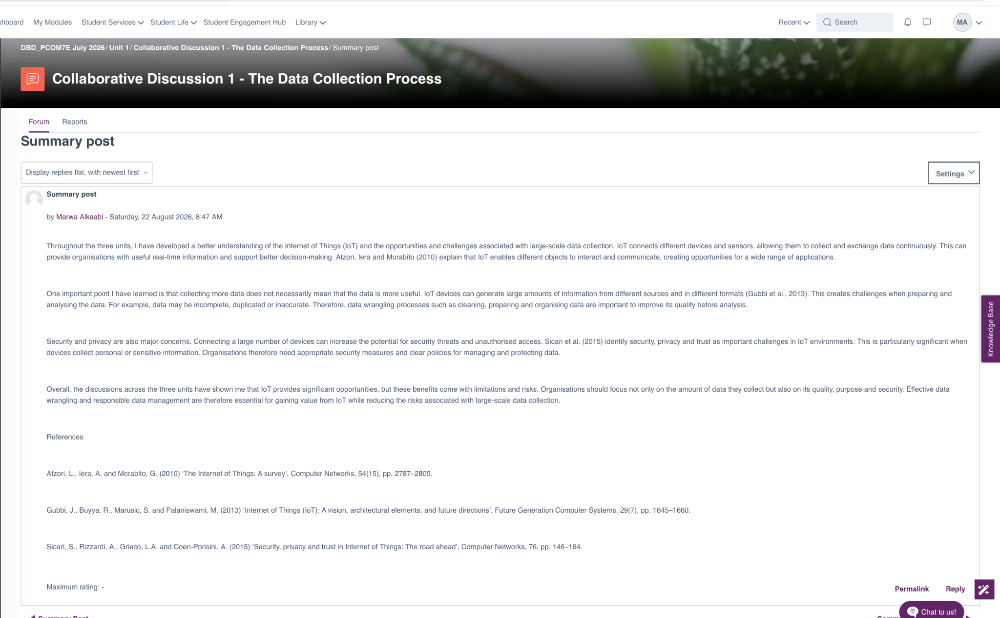

## Unit 4: Data Cleaning and Transformation

### Data Management Pipeline and Data Cleaning

In Unit 4, I developed my understanding of data cleaning and transformation and their role within the data management pipeline. The unit highlighted the importance of preparing data before analysis and considering factors that may affect data quality.

I learned that data cleaning and transformation are important stages in the data pipeline because data may contain errors, inconsistencies or unsuitable formats. Preparing and transforming data helps improve its quality and makes it more appropriate for further analysis.

The unit also introduced the relationship between data management, data cleaning and process automation. This helped me understand that effective data preparation is not simply about correcting individual errors, but about considering how data moves through the wider pipeline.

### Reflection

The Data Management Pipeline Test helped me check my understanding of the concepts covered in this unit. I achieved a score of 10/10 (100%). This demonstrated that I had understood the key concepts relating to the data management pipeline.

The unit has strengthened my understanding of the importance of data quality and preparation. I can also see how these concepts connect with the earlier units, particularly data collection, storage and data wrangling.

### Evidence

- Data Management Pipeline Test result: 10/10 (100%)

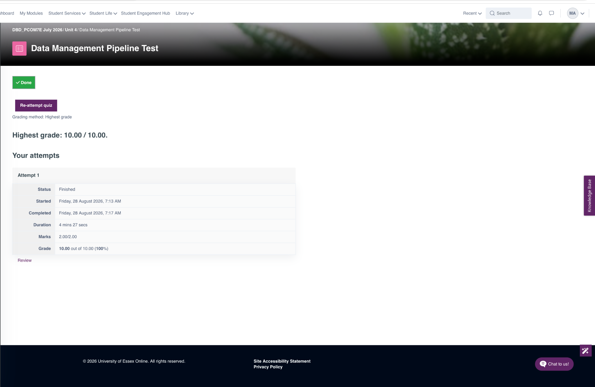

## Unit 5 – Data Pipeline Automation and Data Wrangling

### Overview
Unit 5 introduced important concepts related to big data computing, data pipeline automation, and data wrangling using Python. The reading materials focused on how data pipelines support the movement and processing of data and how tools such as Pandas and NumPy can be used to prepare datasets for analysis.

### Key Learning Topics
- Understanding the purpose of data pipelines in big data environments.
- Exploring how automation can improve data processing workflows.
- Understanding the role of Python, Pandas, and NumPy in data preparation.
- Recognising the importance of data quality and efficient data processing.

### Reflection
The topics introduced in this unit highlighted the importance of organising data processing workflows. Data pipeline automation is particularly relevant when working with large datasets because it can reduce repetitive manual tasks and improve consistency. These concepts provide a foundation for understanding more advanced data processing techniques.

### Evidence

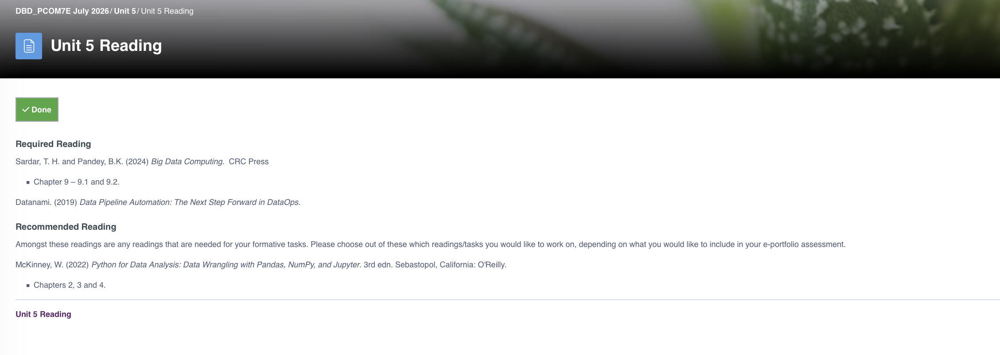
This screenshot shows the reading materials provided for Unit 5, covering Big Data Computing, Data Pipeline Automation, and Python-based Data Wrangling. These resources introduce important concepts related to data processing, automation, and preparing data for analysis.

# Unit 6 – Database Design and Normalisation

## Introduction

In Unit 6, I developed my understanding of database design, data integrity and normalisation. This unit helped me connect the theoretical concepts of relational databases with the practical database work I completed as part of the project. I worked with the Olist Retail database using DB Browser for SQLite and used SQL queries to inspect the structure of the data and analyse relationships between tables.

## Database Structure

As part of my project work, I examined the main tables within the database. This helped me understand how the dataset was organised and how different types of information were stored separately.

The database contained 1,000 customer records, 1,000 order records, 1,151 order-item records and 942 product records in the sample I examined.

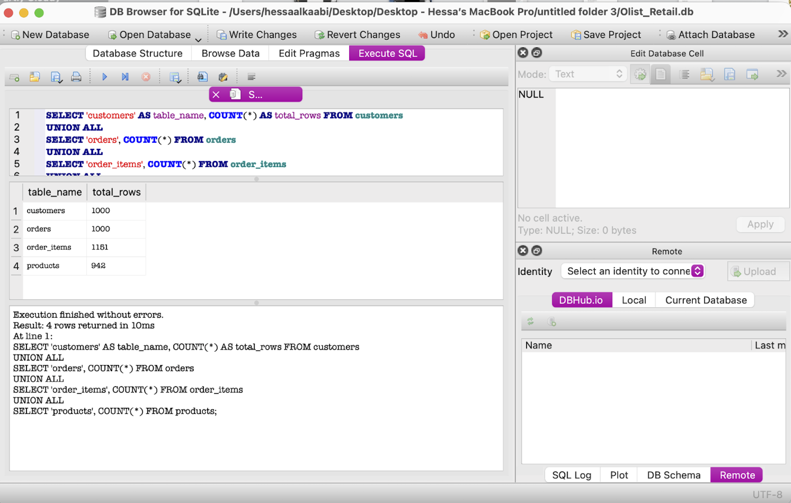

*Figure 1: Checking the number of records in the main database tables.*

This activity helped me understand why database design is important. Separating information into related tables can reduce unnecessary duplication and makes the data easier to manage and analyse.

## Relationships and Foreign Keys

I also investigated the relationships between tables. In particular, I examined the `order_items` table and its foreign-key relationships.

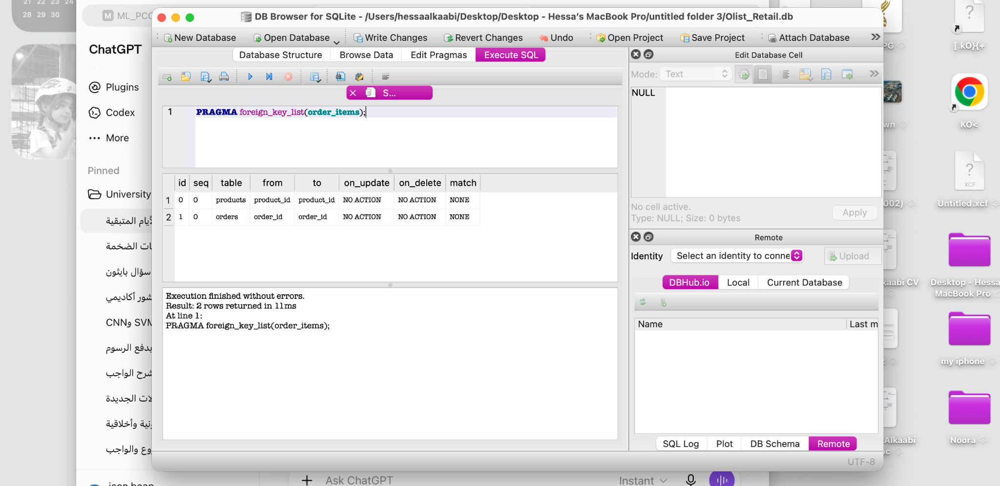

*Figure 2: Foreign-key relationships identified in the order_items table.*

The results showed how `order_items` is connected to other tables through identifiers such as `order_id` and `product_id`. This gave me a clearer practical understanding of primary and foreign keys and how they help maintain relationships between data stored in different tables.

## Using SQL for Data Analysis

After examining the database structure, I used SQL queries to produce useful information from the data. One calculation was the average order value.

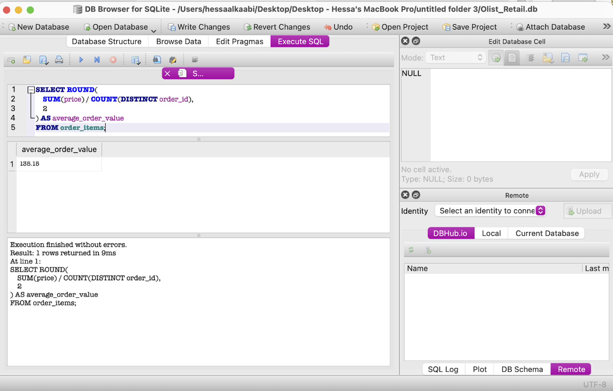

*Figure 3: SQL calculation of the average order value.*

The query produced an average order value of 135.15. This demonstrated how data stored across transactional records can be summarised into information that is easier to interpret.

I also analysed sales according to product category.

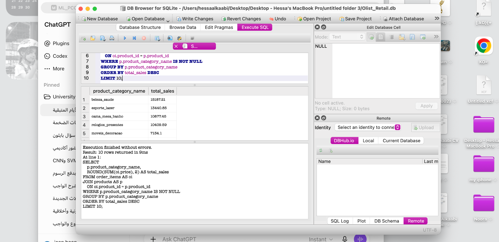

*Figure 4: SQL analysis of total sales by product category.*

This query grouped the data by product category and calculated total sales for each category. It demonstrated how relationships between tables can be used to support more meaningful analysis rather than examining individual records separately.

## Project Development and Change of Direction

My initial project idea focused on developing an AI-assisted relational database for a custodian bank to support Collateralised Loan Obligations (CLOs). However, I later decided to change the project to an e-commerce database analytics solution using the Olist dataset.

The final project focused on designing and implementing a relational database using SQLite, including data preparation, primary and foreign key relationships, data integrity checks, and SQL-based sales analysis.

This change allowed me to develop practical experience in relational database design, data cleaning, and analysing transactional data. The completed Olist project demonstrates the application of these techniques to a real-world dataset.

## Reflection

Unit 6 provided an opportunity to apply database design and SQL techniques to a practical project. Working with the Olist E-Commerce dataset helped me understand how relational databases can organise transactional information and support meaningful business analysis.

One of the important aspects of this project was preparing the data and ensuring that the relationships between tables were accurate. I worked with customer, order, product, and order item data, using primary and foreign keys to maintain referential integrity. I also used SQL queries to explore sales patterns and extract useful information.

Changing my initial project idea helped me recognise the importance of selecting a dataset that supports practical implementation and evaluation. Through the completed project, I developed my understanding of data preparation, relational database structures, SQL analysis, and the importance of validating results.

This experience provided a foundation for applying database analytics techniques to future projects.

## Unit 7

## Unit 7 – Constructing Normalised Tables and Database Build

### Normalisation Task

#### Introduction

This task involves converting an unnormalised student dataset into First Normal Form (1NF), Second Normal Form (2NF), and Third Normal Form (3NF).

The original dataset contains student numbers, student names, exam scores, support information, dates of birth, course names, examination boards, and teacher names.

The aim is to reduce data redundancy, improve data consistency, and organise the information into a relational database structure.

#### Step 1: First Normal Form (1NF)

The original table contains multiple course names, examination boards, and teacher names within individual cells. This violates the atomicity requirement of First Normal Form.

To achieve 1NF, repeating groups are separated into individual rows, ensuring that each field contains a single value.

**Example of the 1NF table:**

| Student Number | Student Name | Course Name | Exam Board |
|---|---|---|---|
| 1001 | Bob Baker | Computer Science | BCS |
| 1001 | Bob Baker | Maths | EdExcel |
| 1001 | Bob Baker | Physics | OCR |
| 1002 | Sally Davies | Maths | AQA |
| 1002 | Sally Davies | Biology | WJEC |
| 1002 | Sally Davies | Music | AQA |

This transformation ensures that each cell contains a single value. However, student information is still repeated across multiple rows, which will be addressed in Second Normal Form.

**Assumption:** The exam score is treated as a student-level attribute because the original table provides one score per student rather than a separate score for each course.

#### Step 2: Second Normal Form (2NF)

Second Normal Form (2NF) requires the table to be in 1NF and ensures that non-key attributes depend on the entire primary key rather than only part of it.

In the original student dataset, student details are repeated for every course. To reduce this redundancy, the data can be separated into two tables: Students and StudentCourses.

**Table 1: Students**

| Student Number (PK) | Student Name | Exam Score | Support | Date of Birth |
|---|---|---|---|---|
| 1001 | Bob Baker | 78 | No | 25/08/2001 |
| 1002 | Sally Davies | 55 | Yes | 02/10/1999 |
| 1003 | Mark Hamnill | 90 | No | 05/06/1995 |
| 1004 | Anas Ali | 70 | No | 03/08/1980 |
| 1005 | Cheuk Yin | 45 | Yes | 01/05/2002 |

**Table 2: StudentCourses**

| Student Number (FK) | Course Name | Exam Board | Teacher Name |
|---|---|---|---|
| 1001 | Computer Science | BCS | Mr Jones |
| 1001 | Maths | EdExcel | Ms Parker |
| 1001 | Physics | OCR | Mr Peters |
| 1002 | Maths | AQA | Ms Parker |
| 1002 | Biology | WJEC | Mrs Patel |
| 1002 | Music | AQA | Ms Daniels |

The Students table uses Student Number as its primary key. In StudentCourses, the combination of Student Number and Course Name can be used as a composite key, assuming each student takes each course only once.

This structure reduces repeated student information and separates student-level attributes from course enrolment records.

The StudentCourses table is an intermediate design. Further analysis of dependencies between courses, teachers, and examination boards is required before confirming Third Normal Form.

#### Step 3: Third Normal Form (3NF)

Third Normal Form (3NF) requires the database to satisfy 2NF and eliminate transitive dependencies, where non-key attributes depend on other non-key attributes rather than directly on the primary key.

In the student dataset, teacher names are associated with particular courses. Storing teacher information repeatedly in the StudentCourses table creates unnecessary duplication.

To improve the database structure, the information can be organised into three related tables.

**Table 1: Students**

| Student Number (PK) | Student Name | Exam Score | Support | Date of Birth |
|---|---|---|---|---|
| 1001 | Bob Baker | 78 | No | 25/08/2001 |
| 1002 | Sally Davies | 55 | Yes | 02/10/1999 |
| 1003 | Mark Hamnill | 90 | No | 05/06/1995 |
| 1004 | Anas Ali | 70 | No | 03/08/1980 |
| 1005 | Cheuk Yin | 45 | Yes | 01/05/2002 |

**Table 2: Courses**

| Course ID (PK) | Course Name | Teacher Name |
|---|---|---|
| C01 | Computer Science | Mr Jones |
| C02 | Maths | Ms Parker |
| C03 | Physics | Mr Peters |
| C04 | Biology | Mrs Patel |
| C05 | Music | Ms Daniels |

**Table 3: StudentCourses**

| Student Number (FK) | Course ID (FK) | Exam Board |
|---|---|---|
| 1001 | C01 | BCS |
| 1001 | C02 | EdExcel |
| 1001 | C03 | OCR |
| 1002 | C02 | AQA |
| 1002 | C04 | WJEC |
| 1002 | C05 | AQA |

The StudentCourses table uses a composite primary key consisting of Student Number and Course ID, assuming that each student is enrolled in each course only once.

The Students table stores student-level information, while the Courses table stores course and teacher details. StudentCourses links students to their courses and records the relevant examination board.

This design reduces repeated student and teacher information and helps prevent update anomalies.

**Design assumptions and limitations:**

- Each course is assumed to have one assigned teacher.
- Exam Board is retained in StudentCourses because the same course may use different examination boards.
- The Course IDs are introduced for the proposed database design.
- The tables illustrate a subset of the original data. The remaining student-course records would also need to be included in a complete implementation.

#### Normalisation Task Reflection

This task helped me understand how database normalisation can improve the organisation and consistency of data. By examining the original student dataset, I identified repeating groups and explored how they could be separated into related tables.

Moving through 1NF, 2NF and 3NF demonstrated the importance of primary keys, foreign keys and functional dependencies. It also highlighted that database design requires careful consideration of the relationships and assumptions within the data.

The normalisation process provided useful knowledge for designing relational databases and reducing unnecessary data duplication.

## Data Build Task – Unit 7

### Objective

The Data Build Task required a relational database to be constructed from the normalised student dataset, with linked tables, primary and foreign keys, and referential-integrity testing.

### Database implementation

I prepared a SQLite database design with three linked tables: `Students`, `Courses` and `StudentCourses`. The `Students` table contains student details and one exam score per student, reflecting the original source. The `Courses` table contains course names and teacher names. `StudentCourses` connects students to courses and records the examination board for each enrolment.

The database contains **5 students, 5 courses and 15 student-course records** based on the university task screenshot. `student_number` and `course_id` serve as primary keys in their respective tables, and the composite key (`student_number`, `course_id`) prevents duplicate enrolments. Foreign keys enforce valid links between the tables.

### SQL validation and evidence

The SQL script includes record-count queries, a three-table `JOIN`, and `PRAGMA foreign_key_check`. When the supplied SQLite database was tested, the counts were 5, 5 and 15 respectively, and `PRAGMA foreign_key_check` returned no violations. A test insertion referencing a nonexistent student was also rejected by the database, demonstrating enforcement of foreign-key constraints.

**Evidence files:**

- [SQLite database](unit7_normalisation.db)
- [SQL build and validation script](unit7_database_build.sql)

### Design assumptions and limitations

The university task provides one exam score per student, so it is stored in `Students` rather than being treated as a course-level score. The source associates one teacher with each course, which is assumed to be consistent across students. Examination boards vary for Maths and are therefore recorded for each student-course enrolment. Course IDs were introduced as surrogate identifiers. These assumptions should be reconsidered if more detailed source data become available.

### Reflection

Building this database helped me connect the theory of normalisation with relational database implementation. I explored how separating student details, course details and enrolment records reduces repetition, while primary and foreign keys help maintain data integrity. The validation queries also showed why database testing is necessary before relying on data for analysis.

*Note: The database and script are a worked implementation prepared from the Unit 7 task screenshot; the screenshot alone does not demonstrate that the database was previously built in the university activity.*

## Unit 8

## Unit 8 – Compliance and Regulatory Framework for Managing Data

### Overview

Unit 8 focused on data protection, regulatory compliance, and the responsibilities of organisations when collecting, processing, and storing personal information.

The unit explored the importance of protecting individuals' rights, applying appropriate security measures, and managing risks associated with personal data.

### Collaborative Discussion 2 – Comparing Compliance Laws

#### Initial Post – GDPR and UAE Personal Data Protection Law

As part of Collaborative Discussion 2, I submitted my initial post on 14 September 2026, comparing the data security requirements of the General Data Protection Regulation (GDPR) and the UAE Personal Data Protection Law (Federal Decree-Law No. 45 of 2021).

In my discussion, I examined Article 5(1)(f) and Article 32 of the GDPR, which emphasise the importance of protecting personal data through appropriate technical and organisational security measures.

I compared these requirements with Article 20 of the UAE Personal Data Protection Law, which also requires organisations to implement security measures appropriate to the risks associated with processing personal data.

I identified that both regulatory frameworks adopt a risk-based approach to data security. However, I also highlighted differences in their scope, particularly the exemptions under the UAE legislation for certain categories of data and organisations.

I concluded that these regulations are particularly important in big data environments, where security breaches may affect large numbers of individuals. Measures such as encryption, access management and regular security testing can help organisations reduce these risks.

**Evidence – Initial Discussion Post**

[Unit 8 Initial Post](https://github.com/marwaalkaabi/eportfolio/blob/main/unit8.png)

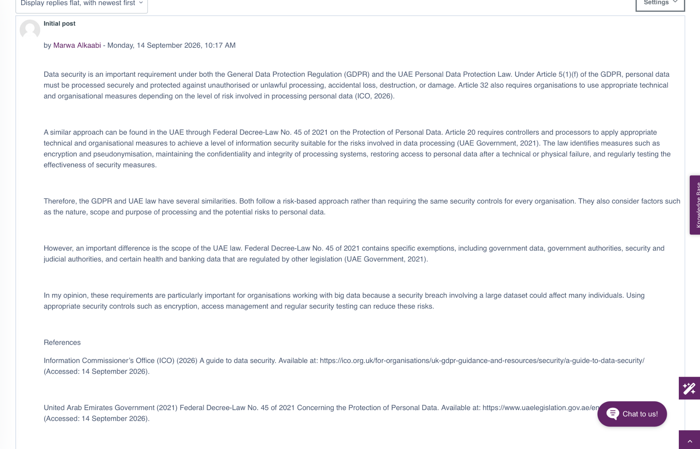

### Reflection

Unit 8 helped me develop a clearer understanding of how data protection legislation influences the management and security of personal information.

Comparing the GDPR with the UAE Personal Data Protection Law allowed me to recognise that, although different jurisdictions have their own regulatory frameworks, they share important principles relating to data security and risk management.

One of the main challenges was identifying both the similarities and differences between the two laws rather than simply describing their requirements. This encouraged me to examine specific legal provisions and consider how they apply to organisations processing large datasets.

I also developed a better understanding of why security measures should be proportionate to the risks involved in data processing. In particular, I recognised the importance of combining technical controls, such as encryption and access management, with organisational responsibilities.

This activity strengthened my ability to compare regulatory requirements and evaluate their practical implications. I can apply this knowledge in future data-related projects by considering privacy, security and legal compliance when designing data processing solutions.

### References

Information Commissioner's Office (ICO). (2026). *A guide to data security*. Available at: https://ico.org.uk/for-organisations/uk-gdpr-guidance-and-resources/security/a-guide-to-data-security/ (Accessed: 14 September 2026).

United Arab Emirates Government (2021). *Federal Decree-Law No. 45 of 2021 Concerning the Protection of Personal Data*. Available at: https://uaelegislation.gov.ae/ (Accessed: 14 September 2026).

## Unit 9

## Unit 9 – Database Management Systems (DBMS) and Models

### Overview

Unit 9 focused on the concepts, design principles, and applications of Database Management Systems (DBMS). The unit introduced different database models, including relational databases, NoSQL databases, data warehouses, and data lakes.

It also explored the strengths and limitations of different database systems and the importance of selecting appropriate database technologies for managing large datasets.

### Collaborative Discussion 2 – Peer Responses

As part of the second week of Collaborative Discussion 2, I responded to two peers on 16 September 2026. My responses built on the discussion of data protection legislation from Unit 8 and explored practical approaches to protecting personal data.

#### Peer Response 1 – Pseudonymisation and Data Minimisation

In my first peer response, I discussed the limitations of pseudonymisation and the possibility of re-identifying individuals when different datasets are combined.

I explained that pseudonymisation alone cannot guarantee anonymity, particularly in big data environments where multiple sources of information may be linked.

I suggested combining pseudonymisation with data minimisation, access controls, and Data Protection Impact Assessments (DPIAs) to reduce privacy risks and support regulatory compliance.

**Evidence – Peer Response 1**

[Unit 9 Peer Response 1](https://github.com/marwaalkaabi/eportfolio/blob/main/unit8-1.png)

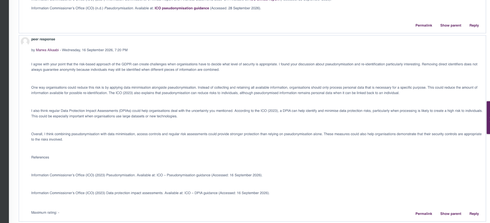

#### Peer Response 2 – Access Control and Data Security

In my second peer response, I discussed the importance of implementing risk-based security measures when organisations process sensitive personal information.

I explored several security controls, including Role-Based Access Control (RBAC), Multi-Factor Authentication (MFA), encryption, regular security testing, and staff awareness training.

I explained that combining technical and organisational security measures can strengthen data protection and help organisations meet their responsibilities under the GDPR.

**Evidence – Peer Response 2**

[Unit 9 Peer Response 2](https://github.com/marwaalkaabi/eportfolio/blob/main/unit8-2.png)

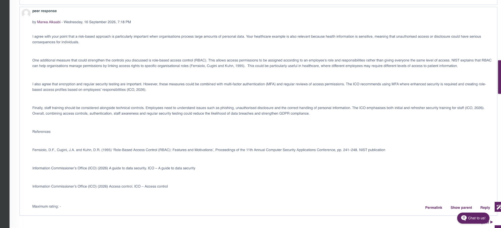

### Reflection

Unit 9 helped me develop a broader understanding of database management systems and the importance of selecting suitable database models for different data processing requirements.

Studying relational and non-relational database systems helped me recognise that database design decisions depend on factors such as data structure, scalability, performance, and application requirements.

The collaborative discussion also allowed me to explore how data protection principles can be applied in practical data management environments.

Through my peer responses, I considered the limitations of pseudonymisation and the importance of combining different security controls to reduce risks associated with processing personal information.

One important lesson was that database management involves more than storing and retrieving data. Organisations must also consider data security, access management, regulatory compliance, and the risks associated with large datasets.

This unit strengthened my understanding of the relationship between database design and responsible data management. I can apply this knowledge in future projects when evaluating database technologies and considering appropriate security measures.

### References

Information Commissioner's Office (ICO). (2023). *Pseudonymisation*.

Information Commissioner's Office (ICO). (2023). *Data protection impact assessments*.

Information Commissioner's Office (ICO). (2026). *A guide to data security*. Available at: https://ico.org.uk/for-organisations/uk-gdpr-guidance-and-resources/security/a-guide-to-data-security/.

Ferraiolo, D. F., Cugini, J. A. and Kuhn, D. R. (1995). Role-Based Access Control (RBAC): Features and Motivations.

## Unit 10

## Unit 10 – More on APIs (Application Programming Interfaces) for Data Parsing

### Overview

Unit 10 focused on Application Programming Interfaces (APIs) and their role in data parsing, system integration, and communication between applications.

The unit introduced the importance of API functionality, security, and resilience, particularly when APIs are used to exchange and process data across different systems.

It also considered the challenges associated with API implementation and the need to protect information during data transmission and processing.

### Collaborative Discussion 2 – Summary Post

As part of the final week of Collaborative Discussion 2, I submitted my summary post on 27 September 2026.

The summary brought together my initial comparison of the General Data Protection Regulation (GDPR) and the UAE Personal Data Protection Law, alongside the feedback received from a peer and the key points explored throughout the discussion.

In my initial contribution, I identified that both regulatory frameworks adopt a risk-based approach to protecting personal data. In my summary, I reflected on how organisations should select security measures according to the nature of the information being processed, the scale of processing, and the potential impact of a data breach.

The feedback I received reinforced the similarities between the UK GDPR and the UAE legislation. It also encouraged me to consider why security requirements should be adapted to different organisational environments rather than applying the same controls in every situation.

I highlighted that technical measures, including encryption and pseudonymisation, must be supported by organisational controls such as access management, staff awareness, regular risk assessments, and security testing.

My main conclusion was that effective regulatory compliance requires continuous attention throughout the data-processing lifecycle, particularly in big data environments where security incidents may affect large numbers of individuals.

**Evidence – Summary Post**

[Unit 10 Summary Post](https://github.com/marwaalkaabi/eportfolio/blob/main/unit8-3.png)

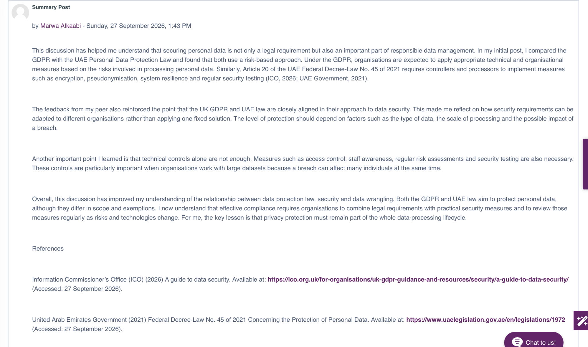

### API Security Requirements

Unit 10 also introduced the importance of securing APIs used for data parsing and communication between systems.

The API Security Requirements activity focuses on identifying security considerations that support reliable API functionality and protect data exchanged between applications.

[To be completed using evidence from the API Security Requirements activity.]

### Reflection

Completing the final stage of Collaborative Discussion 2 helped me consolidate my understanding of data protection legislation and the relationship between regulatory compliance and practical security controls.

One important aspect of this activity was considering the feedback received from another student. This encouraged me to look beyond the similarities between legal frameworks and think more critically about how security measures should be adapted to different organisational requirements.

I also recognised that protecting personal data requires ongoing risk assessment rather than relying on a single technical solution. This is particularly relevant when organisations manage large datasets or exchange information between systems.

The introduction to API security provided a further opportunity to consider how data protection principles relate to application connectivity and secure information exchange.

This learning will be useful in future data-related projects, where I will need to consider not only how information is processed but also how it is protected throughout its lifecycle.

### References

Information Commissioner's Office (ICO). (2026). *A guide to data security*. Available at: https://ico.org.uk/for-organisations/uk-gdpr-guidance-and-resources/security/a-guide-to-data-security/ (Accessed: 27 September 2026).

United Arab Emirates Government (2021). *Federal Decree-Law No. 45 of 2021 Concerning the Protection of Personal Data*. Available at: https://uaelegislation.gov.ae/en/legislations/1972 (Accessed: 27 September 2026).

## Unit 11

## Unit 11 – DBMS Transaction and Recovery

### Overview

Unit 11 focused on database transaction processing, consistency, and recovery mechanisms. The unit introduced the ACID properties (Atomicity, Consistency, Isolation and Durability) and examined how database systems maintain data integrity during transactions and system failures.

The unit also explored transaction scheduling, checkpoints, backup procedures and recovery strategies to ensure that databases remain reliable and consistent.

### Individual Project – AI-Assisted Relational Database and Sales Analytics

As part of the individual project, I developed an AI-assisted database analytics solution using a sample from the Brazilian Olist E-Commerce Dataset.

The project aimed to transform transactional data into a structured relational database that could support sales analysis, management reporting and evidence-based business decisions.

The implementation used SQLite, SQL and Python to prepare, validate and analyse the data. AI-assisted techniques were also used for data profiling, feature engineering and analytical development, with results independently validated.

#### Database Design and Implementation

I organised the dataset into four relational tables:

- Customers
- Orders
- Products
- Order Items

The database contained 1,000 delivered orders, 1,000 customers, 1,151 order-item records and 942 products.

Primary keys, a composite key and foreign-key relationships were used to maintain referential integrity and support reliable SQL joins.

SQLite validation confirmed that the database contained no foreign-key violations.

#### Data Cleaning and Validation

I used Python and Pandas to examine data types, missing values and identifier uniqueness.

The profiling identified 36 missing cells across four descriptive product fields. Rather than replacing unknown values with assumptions, I retained the missing values and excluded null category labels where appropriate.

I also completed nine validation checks covering identifier uniqueness, foreign-key relationships, non-negative prices, freight values and delivery durations.

All nine validation checks passed.

#### Sales Analysis and Findings

SQL queries and Python analysis were used to examine merchandise sales, product categories, customer geography and monthly trends.

The analysis produced the following findings:

- Total merchandise sales: 135,150.38
- Delivered orders: 1,000
- Average order value: 135.15
- Highest-performing product category: beleza_saude (15,187.21)
- Highest-performing customer state: São Paulo (51,137.61)
- Highest-sales month: November 2017 (12,312.79)

These findings were based on the selected sample and were not treated as representative of the entire Olist dataset.

#### Interactive Dashboard

I also developed an interactive HTML dashboard to present the analytical findings in an accessible format.

The dashboard included filters for product categories, customer states and purchase months, allowing users to explore sales performance from different perspectives.

The main dashboard totals were reconciled with the SQL outputs to support consistency and reliability.

### Database Integrity and Recovery Considerations

The project highlighted the importance of maintaining data integrity in relational database systems.

Foreign-key constraints and validation checks helped ensure that relationships between customers, orders, products and order items remained consistent.

The concepts introduced in Unit 11, particularly atomicity, consistency, isolation and durability, are relevant to maintaining reliable transaction processing.

Backup procedures, checkpoints and recovery mechanisms are also important considerations for protecting database availability and preventing data loss.

Although my project validated relational integrity, the submitted executive summary does not document a separate backup-and-recovery implementation or transaction failure simulation.

### Evidence – Individual Project

The individual project was documented in my Executive Summary, submitted in October 2026.

The report includes the database design, data profiling, validation results, analytical findings, dashboard description and recommendations.

**Evidence – Individual Project Executive Summary**

[View Individual Project Executive Summary (PDF)](https://github.com/marwaalkaabi/eportfolio/blob/main/Individual%20Submission.pdf)

### Reflection

Unit 11 strengthened my understanding of the importance of database reliability, transaction consistency and data integrity.

Through my individual project, I gained practical experience in designing a relational database, preparing data for analysis and validating the accuracy of database relationships.

One important lesson was that analytical results should not be accepted without verification. I used both SQLite and Python validation checks to confirm that the data remained consistent and that the analytical outputs were supported by the source records.

I also recognised the limitations of working with a selected sample. Although the analysis identified useful patterns in sales performance, these findings could not be generalised to the entire dataset without further investigation.

The unit encouraged me to consider database reliability beyond data cleaning and analysis, particularly the role of transaction management, backup procedures and recovery mechanisms.

This experience strengthened my technical skills in SQL, SQLite, Python and data validation. It also reinforced the importance of combining analytical development with data governance, documentation and critical evaluation.

### References

Information Commissioner's Office (ICO) (2026). *A guide to the data protection principles*. Available at: https://ico.org.uk/for-organisations/uk-gdpr-guidance-and-resources/data-protection-principles/a-guide-to-the-data-protection-principles/.

National Institute of Standards and Technology (NIST) (2024). *Artificial Intelligence Risk Management Framework: Generative Artificial Intelligence Profile*. Available at: https://doi.org/10.6028/NIST.AI.600-1.

Olist (n.d.). *Brazilian E-Commerce Public Dataset by Olist*. Available at: https://www.kaggle.com/olistbr/brazilian-ecommerce/.

SQLite (2026). *SQLite Foreign Key Support*. Available at: https://www.sqlite.org/foreignkeys.html.

SQLite (2026). *PRAGMA Statements*. Available at: https://www.sqlite.org/pragma.html.

## Unit 12

To be completed.

## Final Project Evaluation

To be completed.

## Professional and Personal Development

To be completed.

## Critical Reflection

To be completed.
